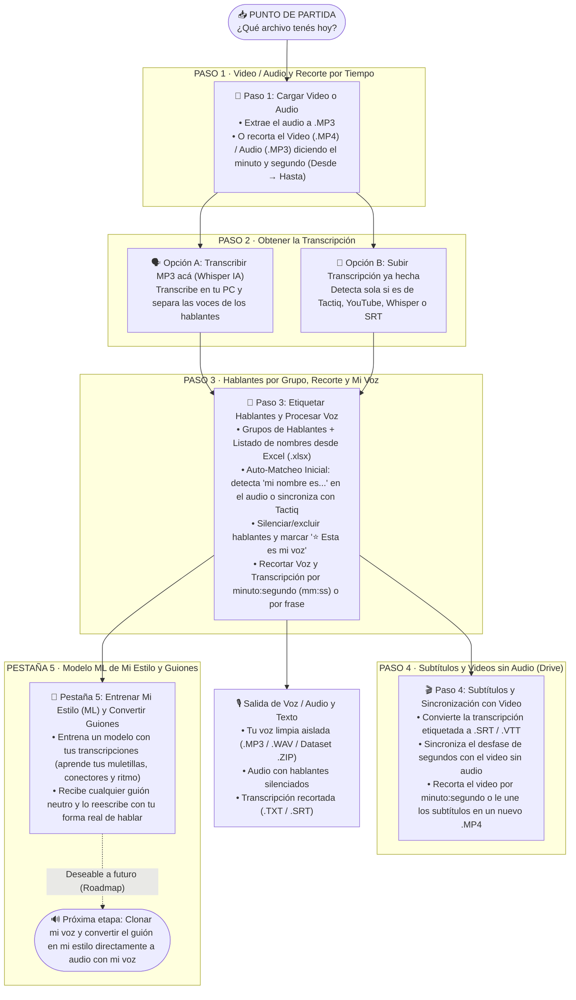

# 🎙️ Estudio de Audio, Hablantes por Grupo, Subtítulos y Estilo ML

Aplicación web **100% local y privada** (`http://localhost:8765`) que reúne en un solo lugar todo el flujo de trabajo para grabaciones, reuniones, edición de voz, subtitulado de videos mudos y adaptación de guiones a tu propio estilo de hablar.

---

## 👋 ¿Qué hace esta aplicación? (Resumen para quien ingresa por primera vez)

No hace falta seguir siempre todos los pasos en orden: **podés entrar directamente a la pestaña que necesites según lo que tengas a mano** (un video crudo, un audio MP3, una transcripción de Tactiq/YouTube o un guión escrito).

| Pestaña | ¿Para qué sirve? | ¿Qué podés hacer ahí? |
| :--- | :--- | :--- |
| **1. 🎵 Video / Audio a MP3 y Recorte** | Convertir formatos y recortar por tiempo | • Subir cualquier video (`.mp4`, `.mkv`, `.mov`, `.avi`) y extraer su audio en `.mp3`. • Convertir cualquier audio (`.wav`, `.m4a`, `.ogg`) a `.mp3`. • **Recortar Video (`.mp4`) o Audio (`.mp3`)** indicando el **minuto y segundo exacto** de inicio (`Desde`) y fin (`Hasta`). • **Dividir en partes (split)** un video y/o audio: en **varios puntos de corte** (`10:00, 25:30, 1:02:15`) o en **partes de duración fija** (cada `10:00`), con vista previa de las partes y descarga de todas en un `.ZIP`. |
| **2. 📝 Transcripción** | Crear o importar una transcripción | • **Opción A (Con IA local)**: Transcribir un MP3 con Whisper y separar las voces de los hablantes (las sesiones quedan guardadas en disco para abrirlas al instante sin volver a esperar). • **Opción B (Subir transcripción ya hecha)**: Subir un archivo `.txt`, `.srt`, `.vtt`, `.docx` o `.pdf`. **Detecta automáticamente si es de Tactiq, YouTube, Whisper o SRT**, y permite recortarla por minuto y segundo. |
| **3. 👥 Hablantes y Mi Voz** | Identificar quién es quién y llevarte lo que necesites | En 3 pasos, uno debajo del otro: **1 · ¿Quién es quién?** Lista compacta de voces: escuchás, escribís el nombre (se guarda solo en el grupo) y marcás **☆ Soy yo** (la app lo recuerda para las próximas). **Completar automáticamente** con Tactiq, por presentaciones ("soy…") o con una lista de nombres (Excel/CSV/TXT). Si las voces quedaron mezcladas, **separar en 2 a 30**. **2 · Revisar la transcripción**: cambiar de persona una línea, corregir texto, excluir líneas y marcar el tramo. **3 · ¿Qué querés llevarte?** Con un tramo elegido (o todo): **Mi voz limpia** (MP3/WAV/dataset ZIP), **Audio sin ciertas voces** (silenciar o quitar), **Transcripción** (TXT/SRT) y **recetas de video** que abren "Video para publicar". |
| **4. 🎬 Subtítulos y Video (Drive)** | Salvar videos grabados sin audio y subtitular | • Ideal para el caso *"grabé un video en Drive, se transcribió bien pero no salió el audio"*. • Convertís la transcripción (con el nombre de cada hablante) en subtítulos **`.SRT`** o **`.VTT`**. • Previsualizás el video local con los subtítulos superpuestos en vivo, sincronizás el desfase de segundos con una frase de referencia, recortás el video por minuto:segundo o unís los subtítulos en un nuevo `.MP4`. |
| **6. 🔇 Video para Publicar** | Publicar o subtitular una clase controlando qué voces se escuchan | • **Vista previa** del video con minuto:segundo, línea de tiempo de lo que se silencia/subtitula y **simulación en vivo** (silencio y subtítulo al reproducir). • **Recetas**: *Publicar sin voces de alumnos* (silencia + subtítulos anónimos), *Subtítulos de los alumnos* (no se los escuchó), *Subtítulos de todo el video* (salió sin audio), *Solo igualar el volumen*. • Por cada voz: **se escucha**, **silenciar** (queda como subtítulo) o **solo subtítulo**; nombres **anonimizados**, **reales** o **sin nombre**; usa transcripciones de la app o de **Tactiq** con **desfase**. • **Igualar el volumen entre voces** (tu voz y la de los alumnos parejas) y **nivelar el volumen general**. • Sale un `.MP4` (con pista de subtítulos si corresponde) + `.SRT`. |
| **5. 🧠 Mi Estilo (ML) y Guiones** | Entrenar un modelo con tu forma de hablar y adaptar guiones | • **Entrenar Modelo ML**: analiza tus transcripciones reales y aprende tus muletillas, conectores (*"vamos a ver"*, *"o sea"*, *"fíjense que"*, *"por ejemplo"*, *"acá"*), ritmo de frase y vocabulario. • **Convertir Guión a Mi Estilo**: le pegás cualquier guión formal o texto neutro y lo reescribe exactamente con tu forma natural de expresarte, mostrando qué fragmentos reales tuyos tomó de referencia (RAG). |

### 🎬 Ejemplo: una clase grabada con OBS

1. **Video / Audio**: recortás el video (por ejemplo, el principio y el final que sobran) y extraés el audio en MP3.
2. **Transcripción**: con ese MP3 hacés la transcripción con Whisper, que separa a los hablantes. Si la clase la transcribiste con Tactiq, subís esa: ya viene con los nombres de cada uno. Si tiene partes que quedaron fuera del video recortado, la recortás al subirla.
3. **Hablantes y mi voz**: etiquetás quién es quién y guardás las voces en el grupo, así en las próximas clases se reconocen solas.
4. **Subtítulos y video**: generás los subtítulos (SRT) para subirlos junto al video, por ejemplo en Drive. Si el video salió sin audio por error, ahí sincronizás la transcripción con la imagen para que no quede desfasada.
5. **Video para publicar** *(opcional)*: si vas a compartir la clase fuera del curso, silenciás las voces de los alumnos y lo que dijeron queda como subtítulo.

### 📊 Diagrama de Flujo del Workflow (De arriba hacia abajo)

---

## 🔄 Sincronizador Automático con GitHub (Uso en varias PCs)

- Al iniciar la app, verifica automáticamente el estado del repositorio con GitHub:
  - Si actualizaste el código o registraste voces desde otra PC, hace **`git pull` automático**.
  - Si tenés cambios locales nuevos, los comitea y hace **`git push` automático** (incluyendo `voces_registradas.json` y el modelo de estilo, omitiendo los audios pesados).
- En la esquina superior derecha siempre ves el estado de sincronización y el botón **`🔄 Sincronizar`**.

---

## 🚀 Cómo iniciar la aplicación

1. Hacé doble clic en **`Extraer audio.bat`** (o ejecutá `python app.py` en la terminal).
2. Se abrirá automáticamente `http://localhost:8765` en tu navegador.

### Requisitos del sistema
- **Python 3.10+** con `numpy`, `scipy` y `faster-whisper` (o `openai-whisper`).
- **ffmpeg** instalado y disponible en el `PATH`.
- **git** instalado para la sincronización entre PCs.

---

## 🌟 Deseables a Futuro (Roadmap — Próximas etapas)

1. **🗣️🎙️ Clonar Mi Voz y Convertir el Guión en Mi Estilo directamente a Audio con Mi Voz**:
   - **Etapa A (Clonación de Voz)**: Usar los audios limpios y el `Dataset ZIP` exportados en el **Paso 3** para entrenar un modelo local de clonación de voz (**XTTS-v2**, **F5-TTS** o **RVC**).
   - **Etapa B (Texto en Mi Estilo → Audio con Mi Voz)**: Que el guión ya convertido a tu estilo en la **Pestaña 5** tenga un botón para sintetizar el audio `.mp3` / `.wav` hablado directamente con tu propia voz clonada.
2. **🗂️ Jerarquía Multinivel de Grupos de Hablantes (Categoría → Área → Subgrupo)**:
   - Expandir el selector de **Grupos de Hablantes** del Paso 3 para permitir agrupar perfiles de voz en niveles jerárquicos personalizados (por ejemplo *Categoría / Proyecto / Subgrupo*).
